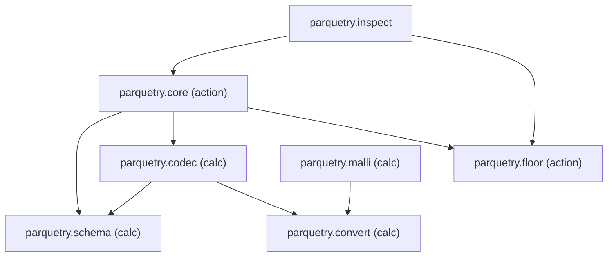

# Splitting `parquetry.core`

`parquetry.core` (415 lines) holds four independent design decisions in one
file. This splits it so each lives in one namespace, keeps `parquetry.core` as
the only API most callers need, and fixes one bug found on the way.

## Ubiquitous language

| Term | Meaning |
|---|---|
| **column** | A map `{:name :type :null? :precision :scale :utc?}`; what callers write. |
| **schema** | A vector of columns. |
| **field** | Parquet's `PrimitiveType` for one column. Never seen outside `schema`/`codec`/`floor`. |
| **message type** | Parquet's `MessageType`: the root plus its fields. |
| **conversion** | A JDK-only value transform, e.g. `Instant` ↔ epoch micros. |
| **encoder** / **decoder** | Per-column fn: Clojure value → stored value, and back. |
| **footer** | The file metadata parquet keeps at the end of a file. |

## Strata map

| Layer | Namespace | Kind | Owns the decision |
|---|---|---|---|
| API | `parquetry.core` | action | What callers call: `write!`, `read`, `rows`, `file-columns`, `file-schema`. |
| API | `parquetry.inspect` | action + calc | Diagnosing an artifact (unchanged role). |
| API | `parquetry.malli` | calc | Deriving a schema from malli (unchanged role). |
| Domain | `parquetry.schema` | calc | How a column maps to a parquet field, in both directions; INT32-vs-INT64 for decimals. |
| Domain | `parquetry.codec` | calc | Which encoder/decoder a column or field gets. |
| Interop | `parquetry.floor` | action | Driving parquet-floor: `Dehydrator`/`Hydrator`, the String[] path, skip-nil, void returns, footer reads. |
| Utility | `parquetry.convert` | calc | Decimal and timestamp conversions, JDK only. |

## Dependency diagram

Arrows are `:require`s. `malli` depends only on `convert`, so its "core does
not depend on me, I do not depend on core" claim still holds.

## Function contracts

**`parquetry.convert`** (all public, all CALCULATION; moved from core verbatim
in behaviour):
`decimal->unscaled`, `unscaled->decimal`, `instant->micros`, `micros->instant`,
`local-date-time->micros`, plus `micros->local-date-time` (new, for malli's
generator) and `epoch->time [utc? units-per-second v]`.

**`parquetry.schema`** (CALCULATION):
- `message-type [schema root] -> MessageType`. Throws
  `:parquetry.core/unsupported-column-type`.
- `int32-decimal? [column] -> boolean`. The single INT32/INT64 rule, used by
  `codec`.
- `field->column [field] -> column`. Formerly private in core.

**`parquetry.codec`** (CALCULATION):
- `encoder [column round-decimals?] -> (fn [v])`. Throws
  `:parquetry.core/inexact-decimal` when invoked.
- `decoder [field] -> (fn [v])`.

**`parquetry.floor`** (ACTION):
- `metadata [path] -> ParquetMetadata`; `message-type [path] -> MessageType`.
- `write-file! [message-type path row->entries rows] -> long`. Reduces `rows`
  (so any `IReduceInit` works), writes the `[column-name value]` pairs
  `(row->entries row)` returns, and returns the row count.
- `reduce-file [path decoders f init]`. A reduce over decoded rows, closing the
  stream on finish or `reduced`.

**`parquetry.core`** (ACTION). Same signatures as today. `write!` builds one
column writer per column (encoder included) once, then hands the pure
`row->entries` to `floor/write-file!`; `row->entries` throws
`::missing-required`. `message-type` and the five conversion fns stay as `def`
aliases (see Decision).

**`parquetry.inspect`**: `footer` reads through `floor/metadata`. The verdict
`cond` becomes a named calculation `verdict [footer nulls row-count]`.

## Error taxonomy

Unchanged. The keywords stay `:parquetry.core/{unsupported-column-type,
inexact-decimal,missing-required}` even though they're thrown from `schema`,
`codec` and `core`. Callers match on `::pq/...`, so the namespace is part of the
contract. No logging is added.

## Behaviour changes

1. **Bug fix:** `write!` uses `doseq`, so a plain `IReduceInit` (next.jdbc
   `plan`) throws `Don't know how to create ISeq`, contradicting the README.
   It will reduce instead. New test covers it.
2. `decimal->unscaled` coerces with `bigdec` instead of `(BigDecimal. (str v))`.
   The two agree on BigDecimal, long and double. `bigdec` also handles Ratio, where `str` produces "1/3" and the constructor throws.

## Cleanups in passing

- Remove the `;; ---- data / calculations / actions` banners (src and test).
- Trim the 17-line nil-skip comment in `write!` and the ns docstring's history
  paragraph to their one-line *why*. Move the 174,128-row incident to the
  `missing-required` docstring.
- `deps.edn` header: drop the stale `libs/parquet` and `spikes/...` paths.
- `Math/floorDiv` → `clojure.math/floor-div`; `(long (/ n 1000))` → `quot`.
- `field->column`'s `(and (nil? ann) (= int64 ...))` chain → one `condp` on the
  primitive type.
- `README` gains the `:boolean` type (already supported, undocumented) and a
  namespace table row for `inspect`.
- `cljstyle fix` across the tree (it currently flags all 6 files).

## Decision: keep the aliases

`parquetry.core` keeps `message-type`, `decimal->unscaled`, `unscaled->decimal`,
`instant->micros`, `micros->instant` and `local-date-time->micros` as `def`
aliases of their new homes. They were public before the split, and DM-2760 code
may call them as `pq/...`. Six one-line aliases cost less than breaking a caller
we can't see. New code should require `parquetry.schema` / `parquetry.convert`
directly. The aliases can go if the library is ever published under a new major
version.
